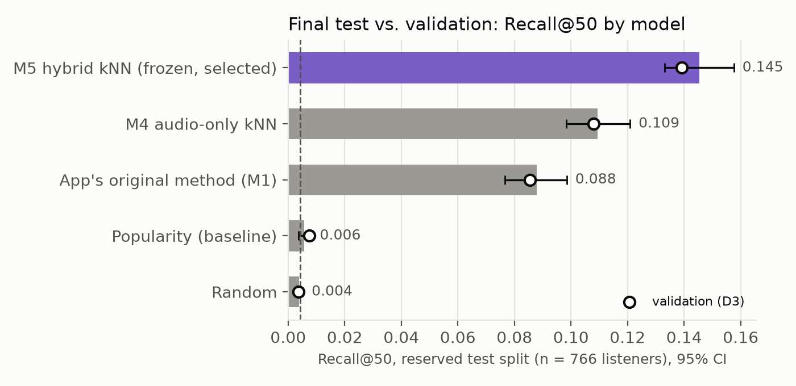
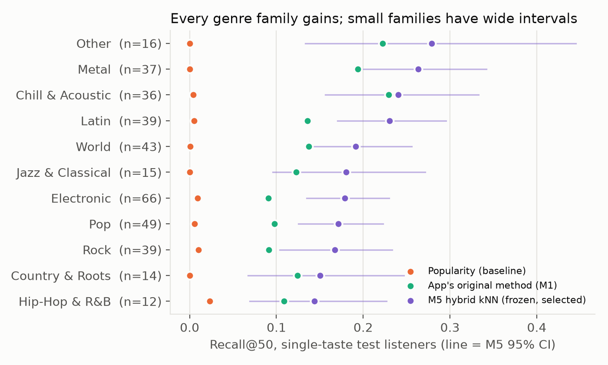

# SwipeTape: Final Report (DTSC 3602, Group 10)

**Team:** Devanshi Parmar, Britain Russell · **Repository:** https://github.com/BigB2405/SwipeTape (tag `d6-final`)  
**App:** https://swipetape-group10.vercel.app · **API:** https://bigb2405--swipetape-api-web.us-east.modal.run ([/docs](https://bigb2405--swipetape-api-web.us-east.modal.run/docs))  
**Research question:** Can shared musical features among songs a user likes or dislikes improve the quality of the personalized playlist produced by a swipe-based recommender?

**Answer in one paragraph.** Yes for likes, no for dislikes. On the reserved test split, opened once for this report, the frozen model finds a listener's held-out songs in its top 50 with Recall@50 **0.145 [0.133, 0.158]**. That is about **26×** the popularity baseline (0.006) and **1.66×** the app's original method (0.088), and both gaps are significant (p < 10⁻³⁴). Adding what a listener *dislikes* changed nothing for the original method and slightly hurt the selected model's family, as it did in validation. The test result matches validation (0.139), so the D3 choice holds on unseen artists.

## 1. Problem and domain rationale
Streaming listeners tend to hear the same trending songs, and small artists rarely reach them. The decision SwipeTape supports is **which songs to queue next for a listener after a few swipes**. It affects listeners, who want to discover music faster, and smaller artists, who need exposure. A recommender that leans on popularity makes the "rich get richer" loop worse, so the project's success criterion is finding songs that *sound like what you liked*, not songs that are popular.

We chose music because the Spotify audio features (danceability, energy, acousticness and so on) let us test a clear idea: is "sounds similar" enough to personalize a playlist without any listening history? It also turns HW1–HW4 into a product people can use. The app shows 30-second previews in a Tinder-style deck. Swipe right to like, left to dislike, up to love, and the model builds a playlist.

## 2. Data
**Source:** the Kaggle *Spotify Tracks Dataset* (maharshipandya, 2022, ODbL): 114,000 tracks × 21 columns, 1,000 tracks for each of 114 search genres. **Preparation** (`scripts/prepare_data.py`, deterministic):
- dropped 1 row with missing text and 450 exact duplicates
- collapsed 16,299 multi-genre listings into one row per track, keeping every genre
- removed 8,397 re-releases
- dropped 300 rows with invalid audio values

That leaves **81,043 tracks**. **Split:** `StratifiedGroupKFold` grouped by primary artist (no artist in two splits, asserted): train 57,801 · validation 11,612 · **test 11,630**. Test was not uploaded to Supabase, not plotted, and not read by any script until this report.

**What the models may use at prediction time:** only the 9 audio features of the swiped songs. Artist, album, genre and popularity are never inputs. Genre labels are used only to *fit* the genre-mix forest inside the pipeline. The D2 data note and dictionary (`docs/D2_data_note.md`) document every column and its role.

## 3. Methods
**Evaluation design (D3, unchanged here).** There are no real swipe logs, so we simulate listeners whose "would like" songs the model cannot see.
- **Single-taste listener:** likes 5 songs by one artist and dislikes 5 songs from other genre families.
- **Mixed-taste listener:** likes 3 + 3 songs by two artists from different families.

The artist's **other songs are held out** and hidden among every track in the split. A model ranks all of them. **Recall@50** is the share of held-out songs ranked in the top 50, and it is the primary metric. Re-releases of a seed are removed from both the pool and the held-out set. Uncertainty comes from a bootstrap over listeners (2,000 resamples), and models are compared with paired Wilcoxon tests. Chance Recall@50 is 0.004.

**Models compared:**

| ID | Model |
|---|---|
| B0 | Random ranking |
| B1 | Popularity: the same top songs for everyone (the baseline) |
| M1 | The app's original method: cosine similarity to the average liked song |
| M4 | Song-to-song kNN on audio |
| M5 (selected) | Song-to-song kNN on [weighted audio ‖ 2 × forest-predicted genre mix] |

M5 uses a soft maximum over liked songs (τ = 0.3), so two different tastes are both served instead of being averaged. Every hyperparameter was tuned with artist-grouped 3-fold CV inside train. M5 was selected in D3 by a rule fixed in advance: highest validation Recall@50, unless a simpler model was statistically tied.

**Pipeline and serving (D4–D5).** M5 is a scikit-learn `Pipeline([SongEmbedder, SwipeRecommender])`. `SongEmbedder` is the custom transformer: it learns a scaler and a 100-tree random forest that maps audio to a genre mix. The pipeline is saved once (`pipeline.joblib`, fit on train + validation, built Nov 18) and served by FastAPI on Modal. Invalid input returns 422, a missing model returns 503, and local and deployed outputs match exactly (`scripts/check_deployed.py`, re-run Nov 22). The Vercel app calls `/recommend` for the end-of-deck playlist, for "Because you liked …" rows and for "Find similar". It has loading and error states and an offline fallback.

**Final test (`scripts/final_test.py`, run Nov 22).** The script loads the **saved artifact and does not refit it**. The comparison models are refit on the same train + validation rows. It reuses the D3 protocol code (`scripts/evaluate.py`) on the test split: **766 listeners** (366 single, 400 mixed) and 11,630 tracks. It asserts that no test artist or track is in the served catalog. It is deterministic: a second run reproduced every number byte for byte.

## 4. Validation and final test results

| Model | Test Recall@50 [95% CI] | Validation (D3) | R@10 | Hit in top 10 | Single | Mixed | Other-album R@50 |
|---|---|---|---|---|---|---|---|
| B0 Random | 0.004 [0.003, 0.005] | 0.004 | 0.002 | 2% | 0.005 | 0.003 | 0.005 |
| B1 Popularity | 0.006 [0.004, 0.008] | 0.007 | 0.002 | 2% | 0.005 | 0.006 | 0.005 |
| M1 App's original | 0.088 [0.077, 0.099] | 0.086 | 0.046 | 24% | 0.135 | 0.045 | 0.072 |
| M4 Audio kNN | 0.109 [0.098, 0.121] | 0.108 | 0.068 | 36% | 0.148 | 0.074 | 0.086 |
| **M5 Hybrid kNN (frozen)** | **0.145 [0.133, 0.158]** | 0.139 | **0.096** | **45%** | **0.200** | **0.095** | **0.119** |



- **Likes: shared features help a lot.** M5 − popularity = +0.140 [+0.127, +0.153] (p ≈ 10⁻⁹⁸). M5 − the app's original method = +0.058 [+0.048, +0.067] (p ≈ 10⁻³⁵). M5 − M4 = +0.036 [+0.027, +0.046] (p ≈ 10⁻¹⁶), so the learned genre-mix signal adds value on top of raw audio. For 45% of listeners, at least one of their artist's other songs is in the first 10 recommendations, against 2% for popularity.
- **Two tastes.** For mixed listeners M5 beats the original method by +0.051 [+0.041, +0.061], and it gets a held-out song from *both* artists into the top 50 for 13.8% of them, against 4.3%. Averaging likes lands between two tastes, while song-to-song matching serves each one.
- **Dislikes: no help.** Adding the disliked-centroid penalty to M1 (λ = 0.15, fixed in D3): −0.001 [−0.006, +0.004], p = 0.99. Adding a dislike penalty to the kNN (λ = 0.3): −0.012 [−0.020, −0.005], p < 0.001. Both match D3.
- **Validation vs. test.** Every model's test score falls within its validation CI. Reusing validation twice in D3 did not inflate the selection.
- **Secondary check (genre match of a 10-song playlist):** P@10 is 0.092 for M5, 0.077 for M1 and 0.015 for popularity.

## 5. Usefulness, errors and limitations
**Useful for the decision?** Yes, as a queueing rule after a few swipes. One like already gives Recall@50 0.129 (n = 367 listeners), 3 likes give 0.185 and 5 give 0.209, so the deck can switch to recommendations after about 3 right swipes. M5 also works best where discovery matters most: for listeners whose seed songs are niche (popularity 0–19, n = 125) it scores 0.196. For hit-lovers (62+, n = 45) it scores 0.094, which is still above popularity's 0.043 even in popularity's best segment.

**Where it errs** (single-taste listeners, `d6_2_by_family.png`):
- **Strongest families:** distinctive sounds such as Metal (0.264, n = 37), Chill & Acoustic (0.240, n = 36) and Latin (0.230, n = 39).
- **Weakest families:** Hip-Hop & R&B (0.144, n = 12), Country & Roots (0.150, n = 14), Rock (0.167, n = 39) and Pop (0.171, n = 49), where artists differ in lyrics, language and era more than in sound.
- **Spot checks** (`reports/d6_spot_checks.md`):
  - An IDM listener (Ochre) gets IDM, techno and Aphex Twin, which is a good playlist.
  - A k-pop listener (j-hope) gets Spanish, German and dancehall tracks with a similar groove. Language and culture are invisible to audio features.
  - The same playlist shows a fixable bug: title variants ("Somebody's Son" vs. "Somebody's Son (Ft Brandy)") get past the same-title filter, so the app should normalize "feat." suffixes.



**Limitations:**
1. **Simulated listeners.** The same artist stands in for "the user will like it". Absolute Recall will not transfer to real users; the *comparison between models* is the claim.
2. **Only prolific artists become listeners**, those with ≥ 8 tracks in the split.
3. **Mixed listeners reuse artists** from single listeners, so the CIs are slightly too narrow. The gaps between models are far larger than that.
4. **Dislikes are simulated** from clearly different families. Real dislikes are subtler.
5. **Static 2022 snapshot**, with no new releases.
6. **Offline only.** We have no A/B test or real swipe logs, so we cannot claim satisfaction, retention or causal effects.

## 6. Bias and fallacy risks, with checks
1. **Popularity bias (feedback-loop risk).** A recommender that favors hits starves small artists, which defeats the project's purpose. *Check:* the median popularity of the top-10 playlists each model would show (`d6_3_popularity_exposure.png`). For M5 it is **35, equal to the test catalog median (35)**, with 49% of picks below the median and 37% of the catalog covered. Popularity's picks have median 87, none below the median, and 0.1% coverage. *Result:* M5 adds no popularity skew.
2. **Proxy fallacy: "same artist" ≠ "you'll like it".** Songs by one artist share producers and albums, so the model could look good by matching production rather than taste. *Check:* Recall@50 restricted to held-out songs from a **different album** than every seed is still 0.119 for M5, against 0.072 for M1 and 0.005 for popularity. *Mitigation:* we report only relative results and do not claim user satisfaction.
3. **Group disparity and the small-sample fallacy.** Ranking genre families by a 12–15-listener average would mislead. *Check:* every family is reported with its n and a bootstrap CI. Country's CI is [0.07, 0.25]. Rock moved from 0.09 in validation to 0.17 in test, a reminder that family-level differences are noisy. Robust finding: M5 ≥ M1 in **all 11 families**, and every family's M5 CI excludes popularity's score.
4. **Sampling bias in the dataset.** The data has 1,000 tracks for every genre, so grindcore is as common as pop. That is nothing like real listening, where pop dominates, and the model is weakest exactly in Pop, Rock and Hip-Hop. *Check:* the by-family table shows the weak families. *Mitigation:* we state that the results describe this curated catalog. Re-weighting families to real listening shares, or collecting real swipes, is the next step.
5. **Filter-bubble risk.** 39% of M5's picks come from the seeds' own genre family (34% for M1, 17% for random). That is moderate, and 61% of picks cross families, but the app's "Hidden gems" row is there to widen exposure.

**Reuse and leakage disclosures:**
- Validation was used twice in D3. The test split was used **once**, on Nov 22, 2026, with all settings frozen.
- The dislike comparison in §4 was added after the first test run, to answer the question's dislike half. It uses the D3-fixed settings and its own random stream, and no other number changed.
- Before D5, the app's `songs.json` held 5,010 test-split songs for browsing. They were never used to fit, tune or select any model. D5 rebuilt the file from train + validation only (asserted).

## 7. Conclusions
- **Shared audio features of liked songs improve a swipe-based playlist**, and by a lot. The frozen hybrid kNN finds listeners' held-out songs 26× more often than popularity and 1.66× more often than the app's original method, on artists it has never seen.
- **Matching song to song**, rather than averaging, is what serves listeners with more than one taste.
- **The features of disliked songs do not help** and should not drive the ranking. In the app, dislikes only remove songs from the deck.
- **It meets the discovery goal:** recommendations are as popular as the catalog median, not the charts.
- **Next steps:**
  - normalize "feat." title variants
  - add language and lyrics signals for Pop and Hip-Hop
  - fill playlists round-robin across seeds
  - evaluate with real swipes logged by the deployed app

## 8. Reproducibility, contributions and AI use
**Reproduce:**
```bash
uv sync
uv run python scripts/prepare_data.py          # D2 data and split
uv run --frozen python scripts/evaluate.py     # D3 comparison
uv run --frozen python scripts/train_pipeline.py
uv run --frozen python scripts/final_test.py   # D6 test
uv run --frozen python scripts/plot_d6.py
```
The README links the data source, the Supabase and Modal setup, Postman (23/23 assertions passing against the deployed API) and the screenshots. No credentials are in the repository.

**Contributions:**
- **D2:** Devanshi Parmar: data preparation, plots, data dictionary, dashboard code. Britain Russell: Supabase load, Modal deployment, final data note.
- **D3:** Britain Russell: evaluation design and model code. Devanshi Parmar: review, reproduction, note revision.
- **D4:** GitHub user `ashroff23`: pipeline refactor, FastAPI service, tests, Postman. Britain Russell: artifact, Modal fix, local-vs-deployed check.
- **D5:** Britain Russell: app redesign, search endpoint, accounts.
- **D6:** Britain Russell: final test script, figures, report draft and slides. _[group to confirm the remaining D6 roles]_

**AI assistance:** Claude Code helped draft code across D2–D6 (preparation, evaluation, pipeline, API, frontend, and the final-test and plotting scripts), the notes and this report. The group reviewed and ran all of it and checked every number against `reports/d6_summary.json`.

**References:** Pandya, M. (2022). *Spotify Tracks Dataset*, Kaggle, ODbL 1.0. · Pedregosa et al. (2011). Scikit-learn: Machine Learning in Python. *JMLR* 12. · Abdollahpouri, H. et al. (2019). The Unfairness of Popularity Bias in Recommendation. *RMSE Workshop, RecSys*.
